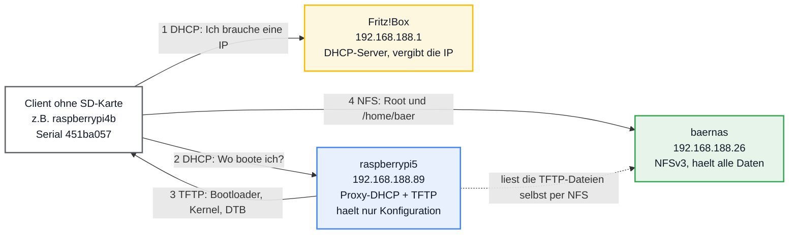
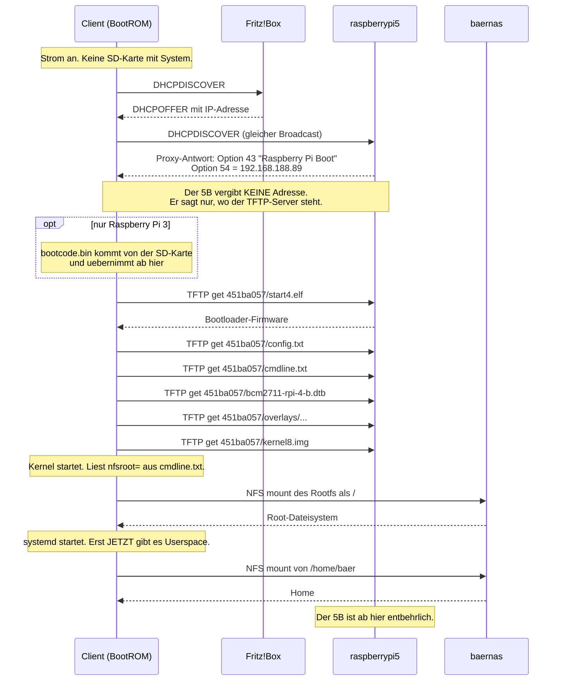
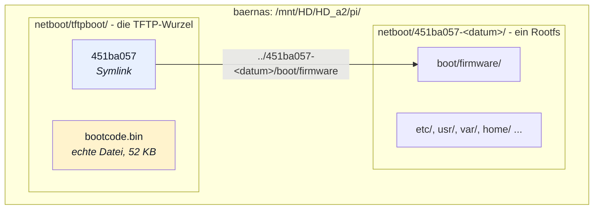
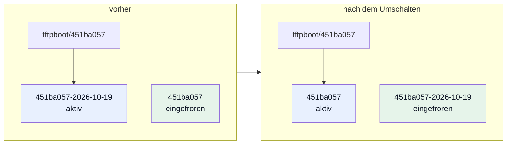
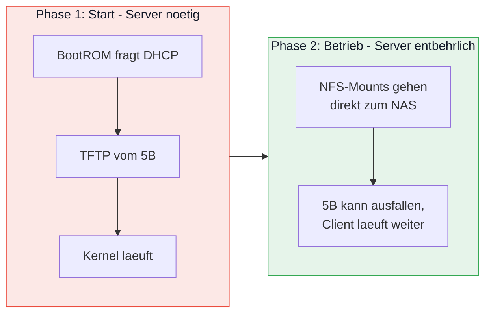
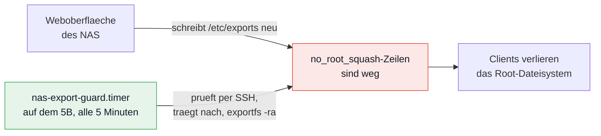
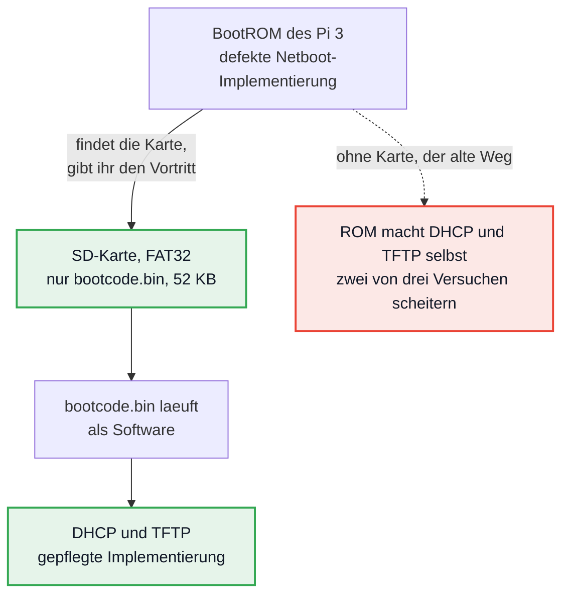

# Wie der Netboot funktioniert

Dieses Dokument erklärt den Aufbau. Es beantwortet: wer holt was von wo, in welcher
Reihenfolge, und warum es so gebaut ist.

Für die Handgriffe siehe [HOWTO.md](HOWTO.md).

Was hier **nicht** steht: welche Stände es gerade gibt, welcher davon aktiv ist, wie viel
Platz frei ist. Das ändert sich mit jedem Eingriff und wird gemessen, nicht nachgelesen —
`./lanboot-stand.sh`, Menüpunkt 1.

Die Menüpunkte sind zweistufig und werden in dieser Datei als `3-1` geschrieben: erst `3`,
dann `1`.

---

## Die Idee in einem Satz

Ein Raspberry Pi ohne SD-Karte fragt beim Einschalten im LAN nach, woher er starten soll,
lädt Bootloader und Kernel über TFTP vom Pi 5B, und holt sein komplettes Dateisystem per
NFS vom NAS.

## Die drei Beteiligten



Der 3B verhält sich genau gleich, nur holt er zusätzlich `bootcode.bin`. Die Nummern
entsprechen den Schritten im Ablaufdiagramm weiter unten.

Die gestrichelte Linie ist der ungewöhnliche Teil: **der Server besitzt die Dateien nicht,
die er ausliefert.** Er hat das NAS gemountet und gibt weiter, was er dort liest.

## Wer holt was von wo

| Wer | Was | Von wo | Wie |
|---|---|---|---|
| Client | IP-Adresse | Fritz!Box | DHCP |
| Client | Adresse des Bootservers | 5B | DHCP-Option 54, vom Proxy-DHCP |
| Client | `bootcode.bin` (nur Pi 3) | SD-Karte | siehe unten, früher per TFTP |
| Client | `start4.elf`, `fixup4.dat` | 5B | TFTP, aus `<seriennummer>/` |
| Client | `config.txt`, `cmdline.txt` | 5B | TFTP, aus `<seriennummer>/` |
| Client | DTB und Overlays | 5B | TFTP, aus `<seriennummer>/` |
| Client | `kernel8.img` | 5B | TFTP, aus `<seriennummer>/` |
| Client | Root-Dateisystem | NAS | NFSv3, Kernel-Mount ohne Userspace |
| Client | `/home/baer` | NAS | NFSv3, per `/etc/fstab` |
| 5B | alles, was er per TFTP ausliefert | NAS | NFSv3, per `/etc/fstab` |

## Der Bootvorgang im Zeitverlauf



### Zwei Stellen, an denen es gern klemmt

**Der Kernel mountet das Root-Dateisystem selbst, bevor der Userspace existiert.**
`userspace` ist alles, was außerhalb des Kernels läuft: systemd, die Bibliotheken, die
Programme in `/usr/bin`, die Shell. Gegenstück ist `kernel space`. Beim NFS-Mount des
Root-Dateisystems läuft davon noch **kein einziger Prozess** — der Kernel macht diesen
Mount selbst, über `CONFIG_ROOT_NFS`.

Es gibt in diesem Moment also keinen Resolver, keine `/etc/resolv.conf`, keine
`/etc/hosts` — denn die lägen auf genau dem Dateisystem, das gerade gemountet werden soll.
Deshalb muss in `nfsroot=` eine **IP-Adresse** stehen. Ein Hostname dort verhindert den
Start garantiert.

Der Home-Mount ist der Gegenbeweis: den macht systemd aus `/etc/fstab`, also im Userspace,
und dort darf ein Name stehen, weil es dann einen Resolver gibt.

**Ein `initramfs` darf nicht dazwischen.** `auto_initramfs=1` gehört nicht in die
`config.txt` eines Netboot-Clients: der Kernel kann `root=/dev/nfs` direkt auflösen
(`CONFIG_ROOT_NFS`), ein initramfs kann das nicht und bricht ab.

## Das wichtigste Muster: der Symlink in das Rootfs

Die TFTP-Wurzel enthält pro Client **keinen echten Ordner**, sondern einen Symlink mit
dessen Seriennummer, der in das `/boot/firmware` des zugehörigen Root-Dateisystems zeigt.



**Warum das der Kern des Aufbaus ist.** Ein `apt upgrade` auf dem Client schreibt einen
neuen Kernel nach `/boot/firmware` und neue Module nach `/lib/modules`. Beides liegt im
selben Rootfs-Baum. Weil TFTP durch den Symlink genau dieses `/boot/firmware` ausliefert,
passen Kernel und Module immer zusammen. Ohne den Symlink hätte man eine zweite Kopie der
Bootdateien, die niemand aktualisiert — neue Module, alter Kernel, und der Client startet
irgendwann nicht mehr.

Nachweisbar ist das mit einem md5-Vergleich: `/boot/firmware/kernel8.img` auf dem Client
und die TFTP-Auslieferung auf dem Server sind dieselbe Datei.

Zweiter Vorteil: die Symlinks sind **relativ**. Verschiebt man den ganzen `netboot`-Baum,
bleiben sie intakt. Und ein Klon per `cp -a` nimmt seine Bootdateien automatisch mit.

## Warum die Seriennummer?

Das BootROM setzt sein TFTP-Präfix im Standard auf die eigene Seriennummer. Jeder Pi fragt
also von sich aus nach `<meine-seriennummer>/start4.elf`. Daraus folgt:

- An dnsmasq und der Fritz!Box ändert sich **nichts**, wenn ein Client dazukommt. Der
  Proxy-DHCP antwortet jedem Pi gleich.
- Die Zuordnung „welche Hardware bootet welches System" steckt **allein im Symlink**.
  Nicht in der Serverkonfiguration, nicht im DHCP, nicht in einer MAC-Tabelle.
- Will man einer Maschine ein anderes System geben, biegt man einen Symlink um. Das ist
  der ganze Vorgang.

Die Seriennummer findet man mit `grep Serial /proc/cpuinfo | cut -c19-26`. Beim Pi 3 sind
es die letzten sechs Stellen der MAC mit einem Präfix, beim Pi 4 und 5 nicht mehr.

## Stände: mehrere Systeme pro Gerät

Aus dem Symlink-Muster folgt unmittelbar etwas Nützliches. Der **Verzeichnisname des
Rootfs ist frei wählbar** — nur der Symlink muss die Seriennummer tragen. Also kann ein
Gerät beliebig viele Systeme auf dem NAS haben, und welches davon startet, entscheidet ein
Symlink.

Ein **Stand** ist so ein System: ein vollständiger Rootfs-Baum mit **eigenem Home**. Keine
Hardlinks, kein overlayfs, nichts geteilt. Zwei Stände haben nichts gemeinsam außer der
Hardware, auf der sie laufen können.



**Eingefroren** heißt: es zeigt kein Symlink darauf. Dann bootet den Baum kein Gerät, also
schreibt auch keines aus dem Betrieb hinein — kein `apt`, kein Journal, keine
`machine-id`. Es braucht kein read-only-Flag, keine Sperre, keinen Schreibschutz, die
Abwesenheit des Symlinks genügt.

Es ist kein Schreibschutz im Wortsinn, und einmal nutzt das Script das auch aus: Menüpunkt
3-3 ändert die Beschreibung eines beliebigen Stands, auch eines eingefrorenen. Angefasst
werden dabei nur `/etc/lanboot-stand` und `/etc/motd`, zwei reine Anzeigedateien. Alles
andere im Baum bleibt unberührt.

**Umschalten ist kein Kopieren.** Zwischen zwei bestehenden Ständen wechselt man, indem der
Symlink umgebogen wird. Das dauert Sekundenbruchteile, legt nichts an und verändert nichts
außer diesem einen Symlink. Wirksam wird es beim nächsten Start des Geräts; ein laufender
Client merkt davon nichts, weil er keine Verbindung zum 5B hält.

Kopiert wird nur, wenn ein **neuer** Stand entstehen soll. Das kostet dann den vollen Platz
des Baums, grob gut 3 GB, und auf diesem NAS einige Minuten.

### Warum das Home dazugehört

Ein Stand ohne eigenes Home wäre nur halb unabhängig. Die `fstab` jedes Stands zeigt auf
`home/<hostname>/<stand>/baer`, also auf sein eigenes Home. Was du in einem Stand im Home
ablegst, ist in einem anderen nicht da.

Das hat eine Konsequenz, die man wissen muss: fällst du auf einen älteren Stand zurück,
bekommst du auch das Home von damals. Gelöscht wird dabei nichts — das Home des Stands, den
du verlässt, bleibt liegen und ist beim Zurückwechseln wieder da.

Die **Ursprungsstände** sind die Ausnahme. Das sind die Bäume ohne Datum im Namen,
`netboot/451ba057` und `netboot/bf7cac06`, aus der Zeit vor diesem Verfahren. Ihr Home ist
das gemeinsame `home/<hostname>/baer`, in dem die Schlüssel und `known_hosts` liegen.

### Die Beschreibung

Ein Verzeichnisname sagt, an welchem Tag ein Stand entstanden ist, und an einem Tag können
mehrere entstehen. Was darin steckt, sagt er nicht. Dafür trägt jeder Stand eine
**Beschreibung** in seinem Marker, in der Zeile `notiz=`.

Gefragt wird beim Anlegen einer Kopie, Menüpunkt 3-1, und der Text gehört der **Kopie**,
die dabei entsteht. Vorgabe ist `Kopie von <quellstand>`. Der Stand, den man dabei
verlässt, behält seine eigene Beschreibung — er wird eingefroren, und in einen
eingefrorenen Baum wird nicht geschrieben.

Daraus folgt, was die Beschreibung ist und was nicht: sie ist **kein** Rückblick auf
geleistete Arbeit, sondern das Etikett, das ein Stand bei seiner Entstehung bekommt. Wer
weiß, was in die Kopie hineinkommen soll, schreibt es gleich hin. Wer es erst hinterher
weiß, ändert die Beschreibung nachträglich mit Menüpunkt 3-3 — das ist eine Zeile im
Marker, am Baum selbst ändert sich dabei nichts.

Menüpunkt 3-2 zeigt die Beschreibungen in seiner Auswahlliste. Dort werden sie gebraucht:
man wählt einen Stand nach seinem Inhalt aus, nicht nach seinem Datum.

### Wo man sieht, in welchem Stand man ist

Jeder Stand trägt zwei Markierungen in seinem Baum. `/etc/lanboot-stand` ist die
maschinenlesbare: Typ, Serial, Name, Home, Anlegedatum, Herkunft, Beschreibung. Auch die
Ursprungsstände haben eine; fehlte sie, hat das Script sie angelegt und die Felder aus dem
Baum selbst gefüllt. Und `/etc/motd` zeigt den Namen beim Login:

```
==========================================================
=== STAND 451ba057-2026-10-19-2  (Typ 4b, Serial 451ba057)
=== Weitere Tools installieren
==========================================================
```

Die zweite Zeile ist die Beschreibung aus dem Marker. Der Rahmen richtet sich nach der
längeren der beiden Zeilen und ist rechts offen, weil ein rechter Abschluss bei zwei
verschieden langen Zeilen ausfransen würde. Hat ein Stand keine Beschreibung, bleibt die
Zeile weg. Die Herkunft steht absichtlich nicht dabei: ein zweiter Standname in derselben
Anzeige wurde mit dem eigenen verwechselt.

Der belastbare Nachweis ist aber keine von beiden, sondern `findmnt -no SOURCE /` auf dem
laufenden Gerät. Nur das sagt, was der Kernel tatsächlich gemountet hat.

Verwaltet wird das alles mit `lanboot-stand.sh`, siehe [HOWTO.md](HOWTO.md).

## Der Server wird nur zum Starten gebraucht



Ein laufender Client hat keine Verbindung mehr zum 5B. Seine NFS-Mounts zeigen direkt auf
das NAS. Deshalb hat der Serverwechsel vom 4B auf den 5B am 17. Oktober 2026 den laufenden
3B nicht gestört.

Praktische Folge: **ein Serverwechsel erfordert an keinem Client eine Änderung.** In der
`cmdline.txt` steht die NAS-Adresse, nicht die des Servers. Die Adresse des TFTP-Servers
erfährt der Client dynamisch aus DHCP-Option 54.

Die unangenehme Kehrseite: fällt der 5B aus, startet **kein** Client mehr. Und wenn die
Systempartition des 5B volläuft, ist das dasselbe wie ein Ausfall.

## Das NAS und seine zwei Fallen

Ein WD My Cloud EX2 Ultra. **Kein NFSv4**, nur v2 und v3 — daher steht in allen Mounts
`vers=3`.

**Falle 1: `all_squash`.** Die von der Weboberfläche verwalteten Freigaben zwingen jeden
NFS-Zugriff auf `nobody:share`. Ein Root-Dateisystem ist darauf unmöglich: kein `chown`,
kein `mknod`, also kein `/dev/console`, also kein Start. Deshalb gibt es zwei **von Hand
eingetragene** Exportzeilen mit `no_root_squash`.

**Falle 2: die Firmware überschreibt `/etc/exports`.** Jede Änderung in der Weboberfläche
schreibt die Datei neu, und die handgetragenen Zeilen verschwinden. Passiert das im
Betrieb, verlieren die Clients mitten im Lauf ihr Root-Dateisystem.



Der Watchdog ist also kein Komfort, sondern die Absicherung gegen einen Klick in der
Weboberfläche.

Nebenbei ein Erkennungszeichen beim Blick in Verzeichnislisten: Eigentümer `baernasu share`
heißt SMB von Windows, `nobody share` heißt NFS über eine `all_squash`-Freigabe,
`root root` heißt Zugriff über die handgetragene Freigabe.

## Der Pi 3B war der Problemfall

Beim Pi 3B steckt der Netboot-Code in der Maskenmaske des Chips und ist nicht
aktualisierbar. Die dokumentierten, erst im 3B+ behobenen Fehler schlugen hier voll durch:
Abbruch nach fünf DHCP-Versuchen, kein DHCPREQUEST, abbrechende ARP-Antworten mitten in
TFTP-Übertragungen.

Gemessen am 18. Oktober 2026 scheiterten **grob zwei von drei Startversuchen**, und zwar
nichtdeterministisch: die DHCP-Antworten des Servers waren in allen Fällen byteweise
identisch. Eine Wettlaufsituation im ROM, nichts, was sich konfigurieren lässt. Nach einem
Fehlschlag wachte der Pi nicht von allein auf, es half nur Strom weg und wieder dran.

### Die Lösung: eine SD-Karte mit nur einer Datei



Der Trick ist, dass das ROM **nur noch eine Datei von der Karte laden** muss und danach
nichts mehr zu tun hat. Das Netzwerk übernimmt `bootcode.bin`, und das ist normale,
gepflegte Software statt unveränderlicher Maskenmaske.

Wichtig ist, was **nicht** auf der Karte liegt: kein `start.elf`, keine `config.txt`.
Fände `bootcode.bin` dort ein `start.elf`, würde es von der Karte weiterladen statt ins
Netz zu gehen — und der ganze Netboot wäre ausgehebelt.

Belegt ist die Wirkung am Protokoll: ohne Karte liefert der Server `bootcode.bin` per TFTP
aus, mit Karte nicht mehr. Alles andere, von `start.elf` bis `kernel8.img`, kommt
unverändert weiter per TFTP. Der erste Start mit Karte gelang sofort und dauerte neun
Sekunden, gegenüber vier Versuchen kurz davor ohne Karte.

Und es gibt einen Preis: der 3B startet jetzt nur noch mit lesbarer Karte. Das ROM gibt ihr
den Vortritt und fällt **nicht** auf den alten Netboot zurück. Root und Home liegen
weiterhin auf dem NAS — plattenlos ist der Pi also nicht mehr ganz, aber auf der Karte
liegen 52 KB Bootloader und sonst nichts.

Der Pi 4 hat das Problem nicht. Bei ihm steckt der Bootloader im SPI-EEPROM, und
`BOOT_ORDER=0xf21` heißt: SD, dann Netzwerk, dann endlos von vorn.

## Wo liegt was

```
baernas:/mnt/HD/HD_a2/pi/          (in der Weboberflaeche: /nfs/pi)
├── netboot/                       Export mit no_root_squash
│   ├── <serial>/                  Ursprungsstand eines Geraets
│   ├── <serial>-<datum>/          ein Stand
│   └── tftpboot/                  TFTP-Wurzel
│       ├── bootcode.bin           echte Datei, fuer alle Pi 3 gleich
│       └── <serial>               Symlink -> ../<stand>/boot/firmware
└── home/                          Export mit no_root_squash
    └── <hostname>/
        ├── baer/                  Home des Ursprungsstands
        └── <stand>/baer/          Home eines Stands

raspberrypi5:
├── /etc/dnsmasq.d/pxe.conf                  Proxy-DHCP und TFTP
├── /usr/local/sbin/nas-export-guard.sh      Watchdog
├── /srv/nfs/netboot, /srv/nfs/home          NAS-Mounts
└── ~/gitrepos/raspirepo/lanboot             Projektordner im Monorepo
```

In `nfsroot=` und in der `fstab` ist **nur der lange Pfad** `/mnt/HD/HD_a2/pi/...` gültig.
`/nfs/pi/...` ist derselbe Ort, aber nur in SSH-Kommandos auf dem NAS brauchbar.
